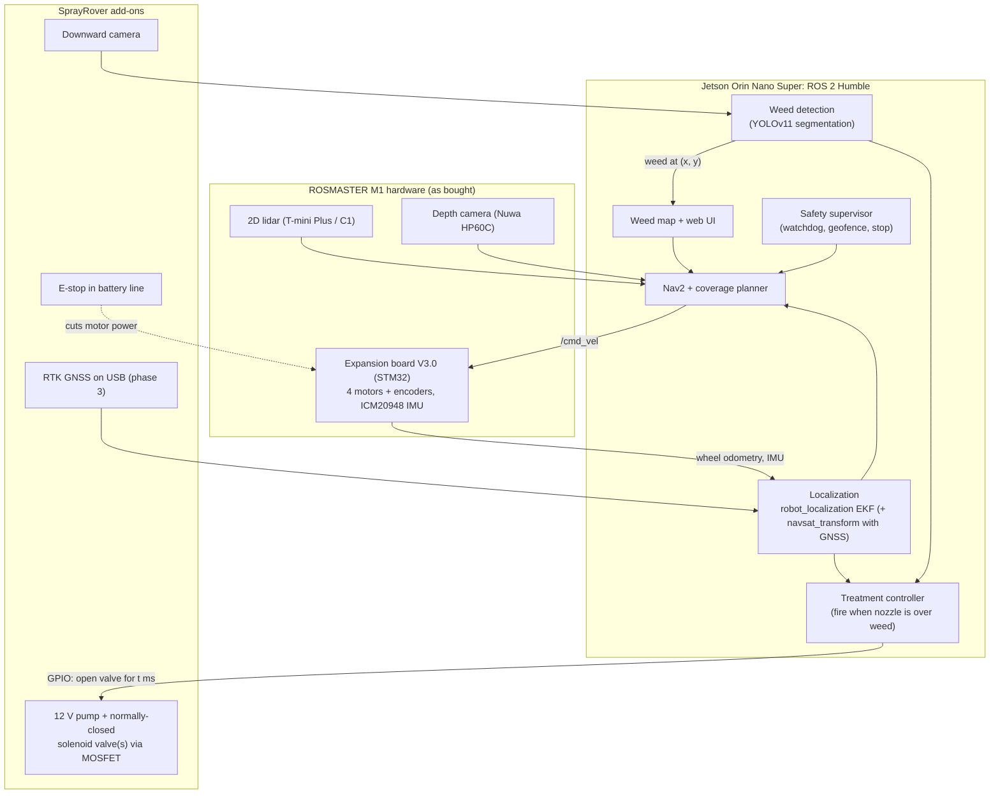

# Concept and Architecture

The recommended technical concept for SprayRover v2, and why. It follows from the
[state of the art](state-of-the-art.md), the [requirements](requirements.md) and the robot we already have:
the [Yahboom ROSMASTER M1](platform-rosmaster-m1.md).

## 1. Main idea: reuse first, build only what is new

v1 started with the hardest and least unique parts: a custom 4-wheel-steering chassis, its own Kalman filter
and a custom radar. v2 turns that around and starts from the ROSMASTER M1, which already gives us a ROS 2
robot with a Jetson, lidar, depth camera, IMU and working Nav2.

| Part | v2 approach | Why |
|---|---|---|
| Robot platform | **ROSMASTER M1** (Jetson Orin Nano Super, ROS 2 Humble, lidar, depth camera, IMU) | Already bought. The software brain can be developed on it right away |
| Weed detection | **YOLOv11 segmentation on the Orin**, trained on our own lawn images. Yahboom's course 13 covers annotation, training and conversion. OpenWeedLocator's green detection as a simple first step on paths | The Orin is fast enough for a segmentation model in real time. No extra AI accelerator is needed |
| Spraying | **OWL-style spray module**: 12 V pump + normally-closed solenoid valve(s), switched from a Jetson GPIO through a MOSFET/relay module | A small add-on. OWL shows the design works |
| Navigation | **Nav2** (already on the M1). For the garden: **robot_localization** fusing IMU + wheel odometry + lidar/visual odometry + RTK GNSS (added later). Coverage planning with opennav_coverage (Fields2Cover) | The standard stack, partly preinstalled. We write configuration and glue |
| Under trees | **Measure first** (phase 0 GNSS survey). Then use lidar/visual odometry (RTAB-Map is already on the M1) and/or UWB beacons where GNSS is weak | Robot-mower makers solve the same problem this way |
| Obstacles | The M1's **lidar + depth camera** with Nav2 obstacle avoidance, plus an E-stop and a watchdog. mmWave radar is a separate research track | Works out of the box indoors. Must be tested outdoors |
| Outdoor chassis (later) | Move the Orin, sensors and software to an outdoor-capable chassis once the software works: converted robot mower, hoverboard base, or v1's 4-wheel steering | The M1 is an indoor robot (mecanum wheels, 12 V motors, no weather protection) |
| Weed map + UI | Our own small ROS 2 node + database + web map | Small and unique to SprayRover |

## 2. Two stages of hardware

| Stage | Hardware | Where it works | What it proves |
|---|---|---|---|
| **Stage 1: M1 development robot** | ROSMASTER M1 as bought, plus a downward camera, spray module, E-stop and (later) RTK GNSS | Indoors on printed and real weed samples, terrace, paths, short dry lawn under supervision | Detection, spray timing, weed map, ROS 2 navigation and coverage, safety logic: everything except driving well on a real lawn |
| **Stage 2: outdoor robot** | Same Jetson, sensors and software on an outdoor chassis | The whole garden, including lawn and slopes | Real garden use |

### Choosing the outdoor chassis (stage 2, decided in phase 4)

| Option | Pros | Cons |
|---|---|---|
| **A. Converted robot mower (OpenMower family)** | Weather-proof, made for lawns, RTK hardware available. ~€700 OpenMower hardware plus the mower | Different controller board (RP2040). We would use our Jetson + ROS 2 stack instead of OpenMower's Pi software, or bridge them |
| **B. Differential-drive hoverboard base** | Cheap, strong 36 V hub motors with air tyres. One stock board drives both motors with [hoverboard-firmware-hack-FOC](https://gitee.com/dream_maker_w/hoverboard-firmware-hack-FOC). Room for tank and electronics | We build the chassis and weather-proofing |
| C. 4-wheel independent steering (v1 plan) | Drives sideways along walls like the M1's mecanum, but on real tyres | Most mechanics and firmware (see Acorn). v1 kinematics are in git history |

Only the ROS 2 drive driver and the URDF model change between the M1 and the outdoor chassis.
**Keep all SprayRover code chassis-independent:** it talks to `/cmd_vel`, `/odom`, `/imu` and camera topics, never to M1 hardware directly.

## 3. System overview (stage 1, on the M1)

## 4. Key design decisions

| # | Decision | Recommendation | Revisit when |
|---|---|---|---|
| D1 | Software framework | **ROS 2 Humble**, as installed on the M1. Move to Jazzy before Humble's end of support (May 2027) or together with the outdoor chassis | Phase 4 |
| D2 | Main computer | **The M1's Jetson Orin Nano 8GB Super.** Moves with us to the outdoor chassis | Detection too slow (unlikely) |
| D3 | GNSS | **ArduSimple simpleRTK3B Budget (UM980)**, ~€223 direct from ArduSimple ([ArduSimple](https://www.ardusimple.com/product/simplertk3b-budget)), on USB to the Jetson, plus a multiband antenna. The ZED-F9P (simpleRTK2B) is the alternative with the largest community | Phase 3 |
| D4 | Corrections | An NTRIP service if available at the address, otherwise our own base station on the house | Measured fix rate (phase 0) |
| D5 | Treatment | Spot spray, water during development. Swappable head (F9) | Rules or results change |
| D6 | Detection model | YOLOv11 segmentation, fine-tuned on our own lawn images, exported for the Orin (TensorRT) as in Yahboom's course 13 | Precision/recall targets not met |
| D7 | Under-tree localization | Decide after the phase 0 GNSS survey: (a) accept short GNSS gaps and dead-reckon, (b) lidar/visual odometry (RTAB-Map), (c) UWB beacons | Survey shows how big the shaded areas are |
| D8 | Outdoor chassis | Decide in phase 4 from the lawn test of the M1 (phase 0) and what stage 1 has shown | Phase 4 |

## 5. How a spray decision works

1. A downward camera looks at the ground in front of the nozzle, at a known calibrated distance.
2. The detector finds a weed in the image. Its position is converted to ground coordinates using the camera
   calibration, then to map coordinates using the robot pose.
3. The treatment controller follows the robot's motion and opens the valve when the nozzle is over the weed.
   With the robot moving at speed `v`, the delay is the camera-to-nozzle distance divided by `v`, minus the
   valve's opening time.
   The M1's mecanum wheels slip, so its wheel odometry is unreliable. Use a short camera-to-nozzle distance
   and low speed, or have the robot stop over each weed.
4. The weed, the image crop and the treatment are stored in the weed map. A follow-up visit (F5) checks the result.

Two things decide whether this works: **timing and calibration.** We measure them first indoors on the M1,
with printed targets and coloured water.
