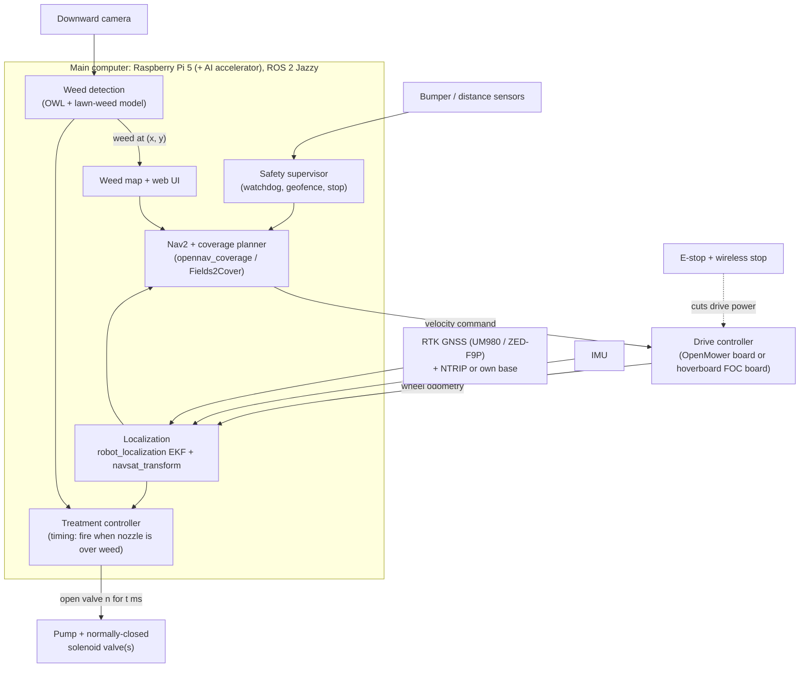

# Concept and Architecture

The recommended technical concept for SprayRover v2, and why. It follows from the
[state of the art](state-of-the-art.md) and the [requirements](requirements.md).

## 1. Main idea: reuse first, build only what is new

v1 started with the hardest and least unique parts: a custom 4-wheel-steering chassis, its own Kalman filter,
and a custom radar. v2 turns that around.

| Part | v2 approach | Why |
|---|---|---|
| Weed detection + spraying | **Start from OpenWeedLocator (OWL)**, extended with a lawn-weed model trained on our own images | It is the unique part of SprayRover, and OWL already solves camera → detection → valve |
| Mobile base | **Simple and proven first**: a converted robot mower (OpenMower) or a differential-drive hoverboard base. 4-wheel steering comes later, if needed | Spot spraying doesn't need crab steering. A working base early is worth more than a perfect one late |
| Navigation | **ROS 2 Nav2 + robot_localization** with RTK GNSS + IMU + wheel odometry. Coverage planning with opennav_coverage (Fields2Cover) | The standard, proven stack. We write configuration and glue, not a navigation system |
| Under trees | **Measure first**, then add camera-based localization or UWB beacons where needed | Robot-mower makers solve the same problem this way. Our own garden decides how much is needed |
| Obstacles | Bumper + short-range distance sensors + low speed first. mmWave radar is a separate research track | Safety must work from day one. The radar idea is valuable but not on the critical path |
| Weed map + UI | Our own small service: a database of weeds and a web map | Small and unique to SprayRover |

## 2. Choosing the mobile base

| Option | Pros | Cons | Verdict |
|---|---|---|---|
| **A. Converted robot mower (OpenMower)** | Chassis, motors, battery, weather-proofing and RTK navigation already work. Big community. ~€700 of hardware plus the mower | Small and low, so camera and spray module must be fitted on top. The cutting deck takes up space. Documentation licence is non-commercial | **Fastest way to an autonomous base.** Recommended if a compatible used mower can be found cheaply |
| **B. Differential-drive hoverboard base** | Cheap, strong 36 V hub motors. One stock hoverboard board drives both motors with [hoverboard-firmware-hack-FOC](https://gitee.com/dream_maker_w/hoverboard-firmware-hack-FOC). Room for tank, camera and electronics. Can later push tools | We build the chassis and weather-proofing ourselves | **Recommended if no mower donor is available**, or if F11 (pushing tools) becomes important |
| C. 4-wheel independent steering (v1 plan) | Crab steering and spinning on the spot, best for walls and edges | 4 steering servos + 4 drive controllers, much more mechanics and firmware. Acorn shows it is a multi-year effort | **Later**, only if A/B can't meet F6 (wall and edge following). v1's kinematics code is kept in git history |

**Before choosing, do one experiment:** the push-cart prototype in phase 1 of the [project plan](project-plan.md)
uses no drive system at all.

## 3. System overview

**Real-time parts stay on microcontrollers** (motor FOC, valve timing if needed, E-stop chain). In both base options
these already exist: the OpenMower RP2040 or the hoverboard STM32. All other software runs in ROS 2 on the Pi.
That is a change from v1, which wanted to avoid ROS 2. v2 relies on reusing Nav2, robot_localization,
OpenMower and coverage planning, and all of those are ROS-based.

## 4. Key design decisions

| # | Decision | Recommendation | Revisit when |
|---|---|---|---|
| D1 | Software framework | **ROS 2 Jazzy** (current LTS) on the Raspberry Pi | Never, unless the Pi can't keep up |
| D2 | Main computer | **Raspberry Pi 5 (8 GB)** + AI accelerator (Hailo or Coral). OWL and OpenMower both run on Pi | Detection is too slow → Jetson Orin Nano |
| D3 | GNSS | **ArduSimple simpleRTK3B Budget (UM980)**, ~€223 direct from ArduSimple ([ArduSimple](https://www.ardusimple.com/product/simplertk3b-budget)), plus a multiband antenna. The ZED-F9P (simpleRTK2B) is the alternative with the largest community and the one OpenMower uses | Pick based on compatibility with the base chosen |
| D4 | Corrections | First an NTRIP service if one is available in the area, otherwise our own base station on the house | Measured fix rate (phase 0) |
| D5 | Treatment | Spot spray, water during development. Swappable head (F9) | Rules or results change |
| D6 | Detection model | YOLO-class segmentation model, fine-tuned on our own lawn images, running on the accelerator | Precision/recall targets not met |
| D7 | Under-tree localization | Decide after the phase 0 garden survey: (a) accept short GNSS gaps and dead-reckon, (b) camera-based visual odometry, (c) UWB beacons | Survey shows how big the shaded areas are |

## 5. How a spray decision works

1. The camera looks down in front of the nozzle row, at a known calibrated distance.
2. The detector finds a weed in the image. Its position is converted to ground coordinates using the
   camera calibration, then to garden coordinates using the robot pose.
3. The treatment controller follows the robot's motion and opens the valve when the nozzle is over the weed.
   With the robot moving at speed `v`, the delay is the camera-to-nozzle distance divided by `v`, minus the
   valve's opening time.
4. The weed, the image crop and the treatment are stored in the weed map. A follow-up visit (F5) checks the result.

Two things decide whether this works: **timing and calibration.** We measure them first on the push cart,
before any autonomy is added.
