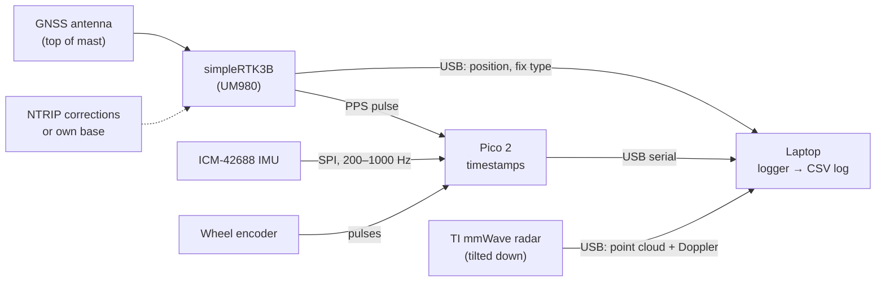

# Measurement Rig: Shopping List and Build Guide

The measurement rig is a garden trolley with sensors that you push around the garden to record data. It
is not a robot. It records GNSS, IMU, wheel speed and radar on one clock, in the log format of
[`navigation/landdvl/logio.py`](../../navigation/landdvl/logio.py), so the
[evaluation software](../../navigation/README.md) can test whether radar halves the error growth when GNSS
disappears.

**Prices:** the ArduSimple board (October 2026) and the TI radar board (DigiKey, November 2026) were
checked. Everything else is an **estimate (est.)**; check before ordering.

## 1. Shopping list

### Sensors

| # | Part | Why | Price |
|---|---|---|---|
| 1 | **ArduSimple simpleRTK3B Budget** (Unicore UM980, triple-band RTK) | Position in cm with RTK fix, and the "truth" in open areas. USB to the laptop, PPS output for time sync. Reusable later on the robot | ~€223 ([ArduSimple](https://www.ardusimple.com/product/simplertk3b-budget)) |
| 2 | **Multiband GNSS antenna** (L1/L2/L5, e.g. ArduSimple's own) + SMA cable | The board doesn't include an antenna, and RTK needs a multiband one | est. 500–1,200 DKK |
| 3 | **RTK corrections:** an NTRIP service, **or** a second simpleRTK3B + antenna as your own base station on the roof | RTK fix needs corrections. Check what NTRIP is available at your address first | NTRIP: subscription (est.). Own base: ~€223 + antenna |
| 4 | **IMU breakout: TDK ICM-42688-P** (SPI/I²C) | Raw rotation and acceleration at 200+ Hz. The same family as in the v1 notes | est. 150–300 DKK |
| 5 | **TI mmWave radar evaluation board IWR6843AOPEVM** (antenna-on-package, 120° × 120° field of view, USB) | Measures the speed of ground points (Doppler). One wide radar tilted down gives many "beams" from one board, which meets the "at least 2 sideways directions" requirement from the [sensitivity analysis](sensitivity.md) | **US$206.51** at DigiKey, status Active, 92 in stock, limit one per 30 days ([DigiKey](https://www.digikey.com/en/products/result?keywords=IWR6843AOPEVM), checked 2 Nov 2026). Field of view: [TI](https://ti.com/document-viewer/lit/html/TIDUEP1A/iwr6843aop-antenna-on-package-evm-id-d7a1c560-4a49-4c58-8dc4-c297aa47ce9a.html). Plus Danish VAT and shipping |
| 6 | **Incremental rotary encoder** (e.g. 600 pulses/rev) with a small rubber wheel pressed against the trolley wheel, or a Hall sensor + magnets on the hub | Wheel speed, like a robot's wheel odometry | est. 100–250 DKK |

### Electronics and logging

| # | Part | Why | Price |
|---|---|---|---|
| 7 | **Raspberry Pi Pico 2** (or Teensy 4.1) | Reads IMU and encoder with precise timestamps and also catches the GNSS PPS pulse, so all sensors share one clock. Streams over USB | est. 50–300 DKK |
| 8 | **Laptop** with Ubuntu 22.04 (a Windows laptop with WSL or a live USB also works) | Runs the logger and writes the CSV log. Use ROS 2 Humble if you want, the same as on the M1 | Have one |
| 9 | **Powered USB hub** + USB cables | GNSS, Pico and radar on one laptop | est. 150–300 DKK |
| 10 | **USB-C power bank** (PD, 20,000 mAh) or a 12 V battery with a USB converter | Power for radar, hub and Pico for 1–2 hours | est. 250–500 DKK |

### Mechanics

| # | Part | Why | Price |
|---|---|---|---|
| 11 | **Garden trolley / pull cart** with air tyres (or a bicycle trailer) | The vehicle. Air tyres give a smooth ride and a realistic slip | est. 300–800 DKK |
| 12 | **Aluminium profile 20×20** (or plywood), angle brackets, M5 screws, hose clamps | A stiff platform and a mast | est. 200–400 DKK |
| 13 | **Antenna mast** 40–60 cm (aluminium tube) with ground plane plate | The antenna must sit above everything and have a free view of the sky | est. 100 DKK |
| 14 | **Splash-proof box** for laptop, Pico and hub, cable glands | Garden conditions | est. 150 DKK |
| 15 | **Tape measure, spirit level / phone inclinometer, tent pegs, spray chalk** | Calibration and marked check points | Have |

**Total excluding base station: about 4,500–8,000 DKK (est.).** The GNSS board, antenna, IMU and radar are
all reused later on SprayRover or on a navigation-module prototype.

### Which GNSS board? (open question Q6)

**Recommendation: keep the simpleRTK3B Budget (Unicore UM980).**
- The rig logger only needs standard NMEA (GGA + GST), which both the UM980 and the u-blox ZED-F9P send.
  So the choice doesn't matter for the rig software.
- The UM980 is triple-band (better RTK fix near trees) and was ~€223 in October 2026.
- The ZED-F9P has the better ROS 2 support: dedicated drivers such as
  [ublox_dgnss](https://github.com/aussierobots/ublox_dgnss/wiki). For the UM980 the route on the robot is a
  generic NMEA driver such as [nmea_navsat_driver](https://github.com/ros-drivers/nmea_navsat_driver). No
  ROS 2 driver made for the UM980 was found.
- Choose the ZED-F9P (simpleRTK2B, ~€156–211 depending on kit,
  [ArduSimple](https://www.ardusimple.com/?p=1766)) only if ROS 2 integration on the robot matters more than
  the third band. ArduSimple's product pages refused automated access on 2 Nov 2026, so **check both prices
  before ordering**.

## 2. How it fits together



## 3. Build guide

### Step 1: Platform
1. Mount a stiff, flat plate on the trolley, over the axle if possible. **Stiffness matters**: vibration
   shows up as IMU noise.
2. Check with the spirit level that the plate is level when the trolley stands on flat ground.
3. Mark a **reference point** (e.g. the centre of the plate above the axle) and an arrow for "forward".
   All sensor positions are measured from here.

### Step 2: Sensors
1. **Antenna:** at the top of the mast, ideally straight above the reference point, with a metal ground
   plane under it. Nothing may be higher than the antenna.
2. **IMU:** screw it rigidly to the plate near the reference point, x axis pointing forward. No foam, no
   tape. It must move exactly with the trolley.
3. **Radar:** at the back of the trolley, tilted **about 45° down** and pointing backwards. Mount it rigidly
   and keep the trolley's own frame and wheels out of the field of view. The radar sees ground points
   behind the trolley at many angles; each point gives one "beam" measurement.
4. **Encoder:** on a wheel that is **not** pulled by the handle. Press the small rubber wheel against the
   tyre with a spring, or mount magnets on the hub for a Hall sensor.
5. Electronics (laptop, Pico, hub, power) in the splash-proof box on the trolley.

### Step 3: Wiring
- simpleRTK3B → laptop via USB. Connect the **PPS** pin to a Pico GPIO, through a level shifter if the
  voltages differ.
- IMU → Pico via SPI (3.3 V).
- Encoder → Pico GPIO with interrupts (A and B channels for direction).
- Radar → laptop via USB, running TI's standard out-of-box demo firmware (point cloud with Doppler).

### Step 4: Software (logger)
**Written (November 2026), tested without hardware.** See [rig-logger.md](rig-logger.md) for how to run it,
the checks to do before the first session, and the limits. What it does:

| Source | What the logger does | Writes to |
|---|---|---|
| Pico | Firmware sends `t_us, gyro_z, acc_x, acc_y` (+ full 6-axis for later) and encoder ticks, timestamped by the Pico clock, which is aligned to the GNSS PPS | `imu.csv`, `wheel.csv` |
| GNSS | Reads NMEA GGA (or Unicore binary), converts lat/lon to local east/north metres using the first fix as origin, maps fix type (4 = RTK fix → `fix`, 5 = float → `float`, else `none`) | `gnss.csv` |
| Radar | Reads TI's point cloud, keeps points on the ground plane, writes each point's radial velocity and direction (`ux, uy, uz` in the trolley frame) | `radar.csv` (point-cloud format) |
| Notes | Date, weather, ground wetness, sensor positions, radar tilt, wheel circumference | `meta.json` |

All timestamps must be on **one clock**. The simplest way is to timestamp everything on the laptop, and
measure and correct each sensor's delay later. The better way is to align the Pico to the GNSS PPS and
timestamp IMU and encoder there.

### Step 5: Calibration (once, and after any change)
1. **Lever arms:** measure x/y/z from the reference point to the antenna, IMU, radar and encoder wheel.
   Write them in `meta.json`.
2. **Wheel circumference:** push the trolley 20 m along a measured straight line (tape on the ground) and
   count encoder ticks. Repeat 3 times. Gives metres per tick.
3. **Radar tilt:** measure the angle with a phone inclinometer.
4. **IMU noise:** leave the trolley completely still for 30 minutes and log. Gives noise and bias numbers
   for `FilterConfig` (Allan variance).

## 4. Measurement procedure (each session)

1. Set up the trolley at a **marked start point in the open**, aligned with a marked line (gives the initial
   heading). Wait for RTK fix.
2. **Stand still for 2 minutes** (the filter learns the IMU biases; it matches the simulator's static start).
3. Drive the route at walking pace:
   - **Open lanes** of 60+ s with continuous RTK fix. These become the artificial-outage test windows,
     because the RTK fix is the truth there.
   - Along the **house wall**.
   - **Under the trees**, then back out into the open.
4. Return to the **start peg** and stand still for 2 minutes. The start point gives a check after the tree
   passages.
5. Write down weather, ground (dry/wet/newly mowed) and anything unusual.
6. Repeat on **at least 3 different days** (dry and wet ground).

Then run:

```bash
python -m landdvl.evaluate logs/2026-11-15_session1
```

The same report as for simulated data appears: error growth with and without radar, and the ratio at 30 s.

## 5. Safety and care
- Power the radar and Pico within their rated voltages, and fuse any 12 V battery.
- Li-ion power bank: keep it out of direct sun, and don't charge it unattended.
- Only drive in dry weather until the box has proved splash-proof.
