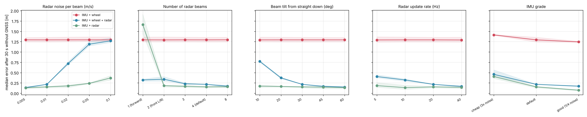

# Which Radar Is Good Enough? (Sensitivity Analysis)

**Simulation results, not measurements.** They show which sensor properties matter and roughly how much, under
the assumptions in `navigation/landdvl/sim.py`. The real test is the
[measurement rig](measurement-rig.md).

Method:
- `python -m landdvl.sweep` changes one property at a time around the default sensors.
- It simulates the 30 × 20 m garden for 3 seeds and runs the artificial-outage test with 15 windows each.
- It reports the **median position error after 30 s without GNSS**, averaged over the seeds.
- Each filter is tuned to the sensor it gets, and wheel-slip detection is on.

## Requirements for the radar (and IMU)

| Property | Requirement | Why |
|---|---|---|
| **Radar velocity noise per beam** | **≤ 0.01–0.02 m/s** | At 0.01 m/s, IMU + radar holds 0.15 m after 30 s, against 1.29 m for IMU + wheel. At 0.05 m/s the combined filter loses most of the gain, because its slip check becomes too loose for noisy radar (IMU + radar alone still holds 0.24 m) |
| **Beam directions** | **At least 2 directions that differ sideways** (e.g. front-left and front-right) | A single forward beam can't see sideways drift. IMU + radar then fails (1.67 m), and it only works together with the wheel. One wide-field TI radar that sees many ground points satisfies this |
| **Tilt from straight down** | **30–60°** | Steep beams (10°) barely see horizontal motion: the error rises to 0.77 m with wheel + radar. 45° is a good choice |
| **Update rate** | **≥ 10–20 Hz** | 5 Hz still helps, but clearly less (0.40 m against 0.22 m at 20 Hz) |
| **IMU** | Default MEMS grade is fine; a better IMU helps the radar-only set most | A cheap IMU with 3× the noise doubles the error (0.40 m). A good one halves it (0.07 m) |

## What this means

1. **The radar idea holds up in simulation across a wide range of hardware.** Almost every configuration
   cuts the 30-second error to a fraction of IMU + wheel.
2. **Radar noise is the property that matters most.** Ask radar suppliers for velocity resolution and noise
   at walking speed (0.2–1 m/s), and measure it on the rig with the trolley standing still and moving at a
   known speed.
3. **Mount it at ~45°** and make sure the ground points spread left and right.
4. **The slip-detection logic must handle noisy radar.** Today the threshold grows with radar noise, so with
   noisy radar slipping wheels get through. Better: compare averaged speeds over ~0.5 s, or estimate wheel
   slip as a filter state.

## Wheel-slip detection (added in the same change)

The filter compares the wheel speed with the radar's own ground speed (least-squares from the beams) and skips
the wheel update when they differ by more than 0.03 m/s + 5 %. Seed 1, 25 windows, default sensors:

| | median 30 s, IMU + wheel + radar | radar ratio at 30 s | max error, whole run with real GNSS |
|---|---|---|---|
| Without slip detection | 0.67 m | 0.49 | 1.07 m |
| With slip detection | 0.23 m | **0.17** | 0.30 m |

## Assumptions to check with real data

- Radar noise is white and Gaussian. There are no outliers from swaying grass, leaves, puddles or the
  trolley's own frame.
- Flat ground; the vertical velocity is zero.
- Perfect time sync and known beam directions.
- Wheel slip only in wet patches under the trees.
