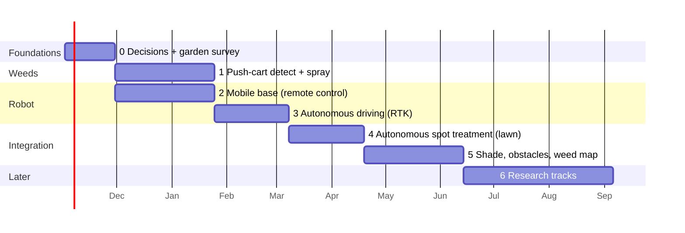

# Project Plan

How we get from an empty repository to a robot that treats weeds in a real garden. Each phase ends with a
**demo you can see** and a **measurable exit criterion**, so we know when to move on and when to stop and rethink.
Durations assume a small hobby team working evenings and weekends, so treat them as rough estimates.

## Guiding rules

1. **The riskiest unique part first.** That is detecting and hitting weeds, not the chassis.
2. **Measure, don't guess.** Survey GNSS coverage in the real garden before choosing a navigation fix.
   Test spray accuracy with targets before trusting it.
3. **Reuse before building** (OWL, OpenMower, ROS 2 Nav2). Write our own code only where nothing fits.
4. **Always working.** Every phase leaves something that runs. No phase is "only integration".
5. **Safety from day one:** E-stop, watchdog and low speed as soon as anything moves on its own.

## Overview

Phases 1 and 2 can run **in parallel**: one person on vision and spraying, one on the base.

## Phase 0: Decisions and garden survey (≈ 4 weeks)

**Goal:** know the garden and fix the big choices.

| Task | Output |
|---|---|
| Measure the garden: lawn area, paths, beds, trees, walls, slopes. Draw a simple map | `docs/garden-survey.md` with a sketch |
| **GNSS survey:** carry the RTK receiver on a pole around the garden for 30 minutes on several days. Log fix status (RTK fix / float / none) per position | A map of where RTK works and where it doesn't. This decides D4 and D7 |
| Collect 500+ photos of the lawn from robot height (~30 cm), in sun, shade and overcast, in all seasons the team can reach | Start of our own dataset |
| Decide on the mobile base: look for a used OpenMower-compatible mower, otherwise go for the hoverboard base | Decision D-base in [concept-and-architecture.md](concept-and-architecture.md) |
| Ask Miljøstyrelsen about automated spot application of approved ready-to-use products | Written answer in [regulations-and-safety.md](regulations-and-safety.md) |
| Set up the repo again: ROS 2 workspace layout, CI, issue board with phases as milestones | Clean, working repo skeleton |

**Exit:** GNSS map done, base decided, 500 photos collected.

## Phase 1: Push-cart weed detection and spraying (≈ 8 weeks)

**Goal:** prove the unique part, with a person pushing instead of a robot driving.

| Task | Output |
|---|---|
| Build OWL (Raspberry Pi 5 + camera + relay board + 12 V pump + 1–4 solenoid valves) on a push cart with a wheel encoder | Working spray cart |
| Run OWL green-on-brown on a gravel path or soil | First automatic spraying (water) |
| Label 1,000+ lawn images, train a segmentation model for lawn weeds, run it on the accelerator | Model with measured precision and recall (P1) |
| Calibrate camera-to-nozzle offset and valve timing. Use the wheel encoder for distance | Hit rate on paper targets (P2) |

**Exit:** P1 and P2 met on the push cart at walking speed, with water.
**If not:** improve the dataset and lighting (camera hood, LED ring) before going further. Don't move on to autonomy.

## Phase 2: Mobile base under remote control (≈ 8 weeks, parallel with phase 1)

**Goal:** a robust base that drives safely around the garden by remote control.

| Task | Output |
|---|---|
| Option A: convert a robot mower with OpenMower. Option B: build a hoverboard base (2 hub motors + stock board with FOC firmware + castor wheel(s)) | Base drives by gamepad or phone |
| E-stop, wireless stop, watchdog (stops without commands for 0.5 s) | P7 measured |
| ROS 2 driver: velocity commands in, wheel odometry out. IMU mounted and calibrated | `/cmd_vel` and `/odom` in ROS 2 |
| Mount points and power for the camera, spray module and GNSS antenna | Mechanical drawing in the repo |

**Exit:** drives a 50 m loop on the lawn by remote control. Safety stop measured. Odometry drift logged.

## Phase 3: Autonomous driving with RTK (≈ 6 weeks)

**Goal:** the base drives coverage patterns on the lawn by itself.

| Task | Output |
|---|---|
| RTK GNSS + NTRIP or own base, robot_localization (EKF + navsat_transform) | Fused pose, P3 measured |
| Record the garden boundary and no-go zones by driving them | Geofence |
| Nav2 + opennav_coverage: coverage path for the lawn. Low speed | Autonomous lawn coverage (P5) |
| Behaviour in GNSS-degraded areas: slow down, dead-reckon, stop if uncertainty is too high | Safe behaviour under trees, P4 measured |

**Exit:** covers the open part of the lawn autonomously three times in a row without intervention.

## Phase 4: Autonomous spot treatment on the lawn (≈ 6 weeks)

**Goal:** the first real SprayRover. Phase 1's spray module on phase 3's base.

| Task | Output |
|---|---|
| Mount the spray module. Use robot odometry in place of the push-cart encoder for valve timing | Hits while driving autonomously |
| Weed map v1: store weed position, image crop and treatment. Web page with the map | F4, F12 |
| Full runs with water and coloured targets. Then, if allowed (phase 0 answer), an approved ready-to-use product on real weeds | P2 and P6 measured on the robot |

**Exit:** an autonomous run over the open lawn treats ≥ 80% of the marked test weeds within ±2 cm.
**This is the MVP.**

## Phase 5: Shade, obstacles and follow-up (≈ 8 weeks)

| Task | Output |
|---|---|
| Use the phase 0 GNSS map to pick the fix for shaded areas: visual odometry with the existing camera, UWB beacons, or better dead-reckoning | P4 met in the real shaded areas (F7) |
| Obstacle detection: bumper + ToF/ultrasound sensors at the front, then camera-based person and animal detection | Stops for obstacles (F8) |
| Follow-up visits: drive back to stored weeds after N days, photograph, re-treat if still alive | F5. First data on how well the treatment works |
| Lawn edges and walls: edge-following behaviour | F6 measured |

**Exit:** a full week of scheduled autonomous runs in the real garden, with a log of every intervention.

## Phase 6: Research tracks (later, optional)

These are the "big ideas" from the original notes. They are valuable, but kept **off the critical path**.

| Track | Idea | Start when |
|---|---|---|
| mmWave radar obstacle detection | TI IWR6843 in front and rear, as described in the v1 notes | After phase 5 obstacle sensing works with simple sensors |
| Self-contained navigation module | Cheap GNSS + IMU + Doppler radar + INS on an STM32, as described in the v1 notes | When phase 5 shows where RTK + fusion is still not good enough |
| 4-wheel steering chassis | v1 kinematics (in git history) on a new chassis | If F6 or F11 can't be met with the simple base |
| Other treatments | Hot water, mechanical tool, low-power laser in an enclosure | If chemical rules tighten, or for paths and terraces |
| Docking and charging | F10 | After phase 5 |

## Rough budget

These are estimates to check when ordering. Only the GNSS board price was verified during research.

| Item | Estimate (DKK) |
|---|---|
| Raspberry Pi 5 + AI accelerator + camera + SD/SSD | 2,000–3,000 |
| Spray module (pump, 1–4 valves, relay board, tank, nozzles, tubing) | 800–1,500 |
| RTK GNSS board (~€223) + multiband antenna | 2,200–3,000 |
| Own RTK base station (optional, second board + antenna) | 2,200–3,000 |
| IMU breakout | 150–400 |
| Base option A: used robot mower + OpenMower hardware (~€700) | 6,000–8,000 |
| Base option B: used hoverboard(s) + chassis materials + castor wheels | 1,500–3,000 |
| Safety (E-stop, remote kill, bumper switches, fuses) | 500–1,000 |
| **Total excluding base station** | **≈ 7,000–16,000** |

## How we work

- **GitHub milestones = phases**, issues = tasks. Each phase's exit criterion is a checklist issue.
- **Branches:** `v2` is the new base branch. Feature branches come from `v2` and are merged back with a pull request.
- **Every measurement goes into the repo** (`docs/results/` with date, setup and numbers), so decisions can be traced.
- **Weekly 30-minute check-in:** what was measured, what blocks, what is next.
